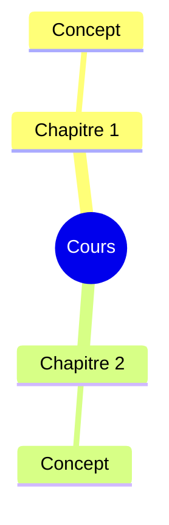

> [!info] Le cours
> **Intitulé :** 
> **Prof :** 
> **Langue :** 
> **Examen :** [[ ]] · **Format :** 
> **Booklet :** [[Booklet ]]

## Vue d'ensemble

## Objectifs (Lernziele)
- 

## Séances
| # | Date | Vorlesung | Note brute | U-Fragen | Thème |
|---|---|---|---|---|---|
| V01 |  |  | [[ ]] | [[ ]] | [[ ]] |

## Chapitres (ordre du booklet)
1. [[ ]] · V01–V03

## ⚠️ Infos examen
-