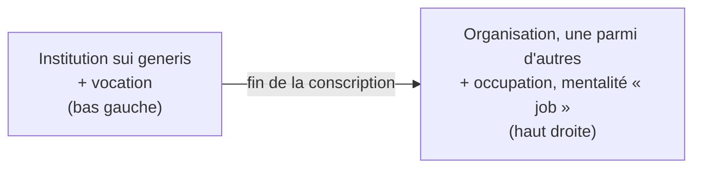

> [!abstract] L'essentiel
> **Définition :** Typologie de [[Charles Moskos]] (1977) selon laquelle l'armée glisse d'une **institution**, légitimée par des valeurs et une vocation, vers une **occupation**, légitimée par le marché comme n'importe quel emploi.
> **Pourquoi c'est important :** Le modèle décrit l'identité du soldat à la fois au niveau de l'armée et au niveau de l'individu ; selon Hofstetter, la fin de la conscription menace ainsi la position particulière (==Sonderstellung==) des forces armées dans la société.
> **Exemple :** Un soldat qui sert par devoir et accepte la disponibilité 24 h/24 (institution) ≠ un contractuel qui compare solde et conditions avec le civil (occupation).

^essentiel

## Explication
- **Hypothèse de base** (Moskos, 1977a) : « the American military is moving from an institutional format to one more and more resembling that of an occupation ».
- **Les deux types :**

| | Institution | Occupation |
|---|---|---|
| Légitimée par | Valeurs et normes, but supérieur à l'intérêt individuel | Le marché : rémunération pour compétences équivalentes |
| Membres | Suivent une vocation (*calling*), « à part » de la société | Ont voix sur salaire et conditions, contre des obligations contractuelles |
| Priorité | L'organisation et le bien commun | L'intérêt personnel |
| Traits militaires | Service 24 h/24, mutations, droit militaire, pas de démission, de grève ni de négociation | Rapport de travail « normal » |

- **La transformation selon Hofstetter (2023b)** : deux axes qui bougent ensemble.
  - Le soldat : obligation de servir / vocation (==Wehrpflicht / Berufung==) -> occupation / activité professionnelle (==Berufstätigkeit==).
  - L'armée : ==Institution sui generis== -> ==Organisation, eine von vielen==.
  - Cause : la fin de la conscription (==Aufhebung der Wehrpflicht==) -> perte de la ==Sonderstellung der Streitkräfte in der Gesellschaft==.
- **Le schéma à savoir dessiner** (VL S. 8, redessiné) : axe horizontal = l'armée, axe vertical = le soldat ; la diagonale représente l'identité idéaltypique, où armée et soldat sont cohérents.

- **Appréciation** (Leonhard et Biehl, 2012) : concept **dynamique** du métier de soldat, qui réunit des éléments sociétaux, organisationnels et individuels, donc plusieurs **niveaux d'analyse** ; a réorienté la sociologie militaire et a été repris dans de nombreux pays.
- **Critique** (Leonhard et Biehl, 2012) :
  - *interne* : attribution floue des variables aux niveaux (Segal, 1986) ; déjà dans les termes, Institution relève du niveau **macro**, Occupation du niveau **micro** (VL S. 8) ;
  - *décisive* : Moskos ne démontre pas sa thèse : la fin de la conscription est le **seul** facteur cité, les autres causes possibles ne sont pas examinées.

## Exemples
- **Militaire :** Une armée de métier qui recrute par des campagnes axées sur salaire, formation reconnue et conditions de travail se rapproche du pôle occupation ; une armée de conscription qui invoque le devoir civique reste plus proche du pôle institution.
- **Civil :** Un pompier volontaire qui s'engage par vocation ≠ un employé d'une entreprise de sécurité privée qui fait le même geste contre salaire.

## Forces / Limites
**Forces**
- Relie le niveau de l'armée et celui du soldat dans un seul schéma.
- Dynamique : décrit un changement, pas seulement un état.
- Réutilisable pour d'autres pays et pour le mouvement inverse ([[Retransformation de l'identité du soldat]]).

**Limites**
- Les pôles ne sont pas du même niveau (macro / micro).
- Explication monocausale (seulement la fin de la conscription).
- Typologie à deux types : simplifie une réalité où les deux logiques coexistent (cf. [[Théorie générale des modèles]]).

## Comparaison / Pièges
| Concept | Différence clé | ⚠️ Piège |
|---|---|---|
| [[Institution]] (sociologie, MilSoz) | Structure d'attentes stabilisée d'une société | Le sens de Moskos est plus étroit : une organisation légitimée par des valeurs |
| [[Organisation]] | Chez Hofstetter : l'armée devenue « une organisation parmi d'autres » | Institution ≠ Organisation sont les pôles de l'**armée** ; Occupation est le pôle du **soldat** |
| [[Retransformation de l'identité du soldat]] | Mouvement inverse, causé par le retour à la défense | Ne pas lui attribuer la cause de Moskos (conscription) |

## Liens
- **Thème :** [[Transformation de l'identité du soldat]]
- **Proche de :** [[Identité du soldat]] · [[Retransformation de l'identité du soldat]] · [[Institution]] · [[Organisation]]
- **Penseur :** [[Charles Moskos]]
- **U-Fragen :** [[UF Lead V08]]

## Questions de compréhension
> [!question]- Sur quoi reposent la légitimité de l'institution et celle de l'occupation ?
> Institution : valeurs et normes, un but supérieur à l'intérêt individuel ; ses membres suivent une vocation. Occupation : le marché, c'est-à-dire la rémunération courante pour des compétences équivalentes ; priorité à l'intérêt personnel.

> [!question]- Pourquoi la critique de Leonhard et Biehl est-elle « décisive » ?
> Parce qu'elle ne porte pas sur la construction du modèle mais sur sa thèse : Moskos affirme un changement de l'armée sans le démontrer, en ne citant qu'une cause, la fin de la conscription.

## Sources
- Moskos, C. C. (1977a), cité dans VL S. 4.
- Hofstetter, P. (2023b). Die Rücktransformation soldatischer Identitäten. *Ethik und Militär* (2).
- Leonhard, N., et Biehl, H. (2012). Beruf: Soldat.
- [[NB Lead V08 - 20261103]]
