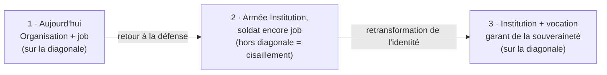

> [!abstract] L'essentiel
> **Définition :** Thèse de Hofstetter (2023b) : le retour des armées occidentales à la défense de l'alliance et du territoire les fait redevenir des armées de défense ; l'identité du soldat doit suivre, de l'activité professionnelle (image **fonctionnelle**) au garant de la souveraineté de l'État (rôle **normatif**).
> **Pourquoi c'est important :** Quand armée et soldat ne bougent pas au même rythme, des **forces de cisaillement** apparaissent entre eux ; elles doivent être absorbées en premier lieu par les cadres.
> **Exemple :** Une armée réorientée vers la défense exige endurance et disponibilité, tandis qu'une partie des soldats raisonne encore en termes d'horaires et de compensation.

^essentiel

## Explication
- **Chaîne causale** (VL S. 19–20) :
  1. ==Rückbesinnung== auf die (==Bündnis-== und) ==Landesverteidigung==
  2. -> les ==Interventionsarmeen== redeviennent des ==Verteidigungsarmeen==
  3. -> en parallèle, l'identité du soldat passe de l'image fonctionnelle (==Berufstätigkeit==) au rôle normatif de ==Garant staatlicher Souveränität==.
- **Lecture sur le schéma du [[Modèle institution-occupation]]** : c'est le chemin de Moskos à l'envers, vers l'institution et la vocation.
  - Pointillé horizontal : l'armée revient vers ==Institution sui generis==.
  - Pointillé vertical : l'identité du soldat doit suivre vers la vocation.
  - Diagonale : ==idealtypische Identität==.
- **Forces de cisaillement** (==Scherkräfte==) : « Abweichungen von der Diagonalen stellen Scherkräfte zwischen Streitkraft und Soldat dar, die primär durch Führungskräfte aufgefangen werden müssen. » Un point hors de la diagonale = une armée et un soldat qui ne se correspondent plus.
- **Lecture du cas typique** (interprétation de Claude, à confirmer en cours) : l'organisation change d'abord ; si l'identité tarde, le point sort de la diagonale (armée « institution », soldat encore « job ») : c'est là que naît le cisaillement.

## Exemples
- **Militaire :** Lors d'un cours de répétition orienté défense, des militaires demandent surtout « combien de temps » et « qu'est-ce que j'y gagne ». Le cadre explique le sens de la mission de souveraineté, incarne les valeurs et traite les frictions avant qu'elles deviennent des conflits (application, complément hors support).
- **Civil :** Un hôpital qui passe en mode crise exige une disponibilité « de vocation », alors que les contrats ont été pensés pour un fonctionnement normal : les cadres de proximité absorbent l'écart.

## Forces / Limites
**Forces**
- Réutilise le schéma de Moskos dans l'autre sens, donc s'apprend facilement.
- Donne un rôle concret aux cadres : absorber l'écart entre armée et soldat.

**Limites**
- Hérite du flou macro / micro du [[Modèle institution-occupation]].
- Le texte du prof dit « en parallèle » ; le décalage dans le temps est une lecture du schéma (à vérifier).

## Comparaison / Pièges
| Concept | Différence clé | ⚠️ Piège |
|---|---|---|
| [[Modèle institution-occupation]] | Cause : fin de la conscription ; direction : vers l'occupation | Cause de la retransformation = changement de **mission**, pas la conscription |
| [[Identité du soldat]] | Élargissement des fonctions (multifonctionnalité) | La retransformation porte sur le **sens** du métier, pas sur le nombre de fonctions |
| [[Prototypicalité de groupe du leader]] | Le leader incarne et façonne l'identité du groupe | Lien utile : le cadre qui absorbe le cisaillement agit en « entrepreneur d'identité » (interprétation) |

## Liens
- **Thème :** [[Transformation de l'identité du soldat]]
- **Proche de :** [[Modèle institution-occupation]] · [[Identité du soldat]] · [[Prototypicalité de groupe du leader]]
- **U-Fragen :** [[UF Lead V08]]

## Questions de compréhension
> [!question]- Pourquoi le retour à la défense exige-t-il une retransformation de l'identité du soldat ?
> L'armée d'intervention redevient une armée de défense ; pour rester cohérent avec elle (sur la diagonale), le soldat doit passer de l'image fonctionnelle du métier au rôle normatif de garant de la souveraineté de l'État.

> [!question]- Que sont les forces de cisaillement et qui doit les absorber ?
> Les écarts à la diagonale, c'est-à-dire les tensions entre ce que l'armée attend et la manière dont le soldat se voit. Elles doivent être absorbées en premier lieu par les cadres.

## Sources
- Hofstetter, P. (2023b). Die Rücktransformation soldatischer Identitäten. *Ethik und Militär* (2).
- [[NB Lead V08 - 20261103]]
