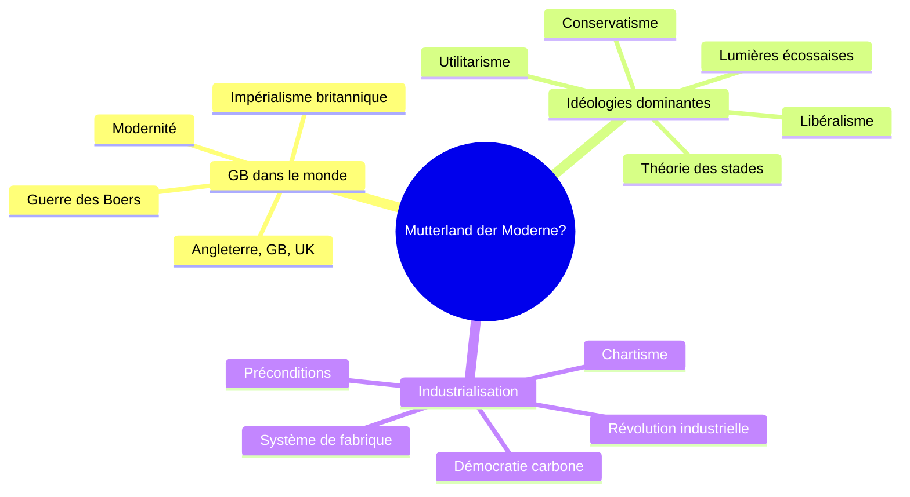

> [!info] Le cours
> **Intitulé :** Geschichte I (Europa) – « Mutterland der Moderne? » Kultur- und Sozialgeschichte Grossbritanniens (ca. 1780–1930)
> **Prof :** Prof. Dr. Harald Fischer-Tiné (TA : Louisa Fröhlich)
> **Langue :** allemand (sources souvent en anglais)
> **Examen :** Abschlussklausur, 16.12.2026 · **Format :** écrit ; une question par chapitre, argument construit

## Vue d'ensemble

## Objectifs (Lernziele)
- Comprendre de façon critique les aspects clés de la [[Modernité]]
- Utiliser le cas britannique pour comparer avec d'autres pays et tirer des conclusions générales
- Analyser des sources historiques et comprendre des textes secondaires faciles à moyens
- Être sensible aux débats historiographiques plutôt que mémoriser des « faits »

## Séances
| # | Date | Vorlesung | Note brute | U-Fragen | Thème |
|---|---|---|---|---|---|
| V01 | 30.09 | Einführung ; GB in der Welt 1780–1939 | [[NB Gesch V01 - 20260930]] | [[UF Gesch V01]] | [[Grande-Bretagne dans le monde]] |
| V02 | 07.10 | « Ruling Ideologies » | [[NB Gesch V02 - 20261007]] | [[UF Gesch V02]] | [[Idéologies dominantes en Grande-Bretagne]] |
| V03 | 14.10 | « Industrial Revolution » | [[NB Gesch V03 - 20261014]] | [[UF Gesch V03]] | [[Industrialisation de la Grande-Bretagne]] |
| V04 | 21.10 | annulée |  |  |  |
| V05 | 28.10 | « The Bitter Cry of Outcast London » |  |  |  |
| V06 | 04.11 | « Dealing with Deviance » |  |  |  |
| V07 | 11.11 | « The Empire strikes back » |  |  |  |
| V08 | 18.11 | « Victorian Morality? » |  |  |  |
| V09 | 25.11 | « Masses and Classes » |  |  |  |
| V10 | 02.12 | « Competing Belief Systems? » |  |  |  |
| V11 | 09.12 | « Integration or exclusion? » |  |  |  |
| V12 | 16.12 | Abschlussklausur |  |  |  |

## Chapitres (ordre du cours)
1. [[Grande-Bretagne dans le monde]] · V01
2. [[Idéologies dominantes en Grande-Bretagne]] · V02
3. [[Industrialisation de la Grande-Bretagne]] · V03

## ⚠️ Infos examen
- Interpretationsarbeit (Quelleninterpretation, 1 200 mots) : 25.11.2026, 23:59, sur Moodle ; réussite obligatoire pour être admis à l'examen
- Abschlussklausur : 16.12.2026 ; compte aussi pour la Basisprüfung Block 2
- Une question par chapitre ; l'Erinnerungskultur revient systématiquement
- Pas de réponse récitée : construire un argument
- Toutes les infos importantes sont données en cours : compléter les notes brutes avec l'oral
