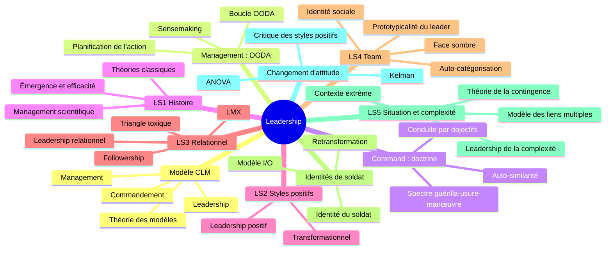

> [!info] Le cours
> **Intitulé :** Leadership (Führung)
> **Prof :** Dr. Patrick Hofstetter (Dozent Führung und Kommunikation, MILAK)
> **Langue :** allemand
> **Examen :** Basisprüfung 2027 – Block 1 · **Format :** écrit

> [!booklet] Booklet de révision
> [[Booklet Lead|📘 Lire]] [🖨️ PDF (A5)](https://aidraxowl.github.io/NEXUS/booklets/booklet-lead.pdf)

## Vue d'ensemble

## Objectifs (Lernziele)
- Utiliser le modèle CLM (Command, Leadership, Management) comme grille de lecture de la conduite
- Expliquer la boucle OODA et en déduire la conduite par objectifs
- Expliquer le lien entre rapport de forces perçu, forme de guerre et style de commandement
- Retracer l'histoire des théories du leadership et distinguer émergence et efficacité
- Décrire les styles de leadership positif et les approches relationnelles, avec leurs limites dans l'armée
- Expliquer le leadership de groupe par l'identité sociale (SIT, SCT, LGP) et en connaître la face sombre
- Dessiner et critiquer le modèle I/O de Moskos ; expliquer la retransformation des identités de soldat et le rôle des cadres face aux forces de cisaillement (déduit des slides V08, pas de Lernziele officiels)
- Diagnostiquer une situation (Stewart, substituts, liens multiples), formuler le paradoxe des contextes extrêmes et le résoudre avec la CLT ; comparer CLT et conduite par objectifs (déduit des slides V09)
- Critiquer la recherche sur les styles positifs (cause-effect conflation, validité interne/externe) ; appliquer les processus d'influence de Kelman à une situation de conduite et lire ses résultats (ANOVA) (déduit des slides V10)
- Objectif à 4 ans : savoir coacher un Cdt U

## Séances
| # | Date | Vorlesung | Note brute | U-Fragen | Thème |
|---|---|---|---|---|---|
| V01 | 15.09 | CLM0 – Théorie des modèles et modèle CLM | [[NB Lead V01 - 20260915]] | [[UF Lead V01]] | [[Modèle de référence de la conduite]] |
| V02 | 22.09 | M0 – Boucle OODA, PA et Suivi Sit | [[NB Lead V02 - 20260922]] | [[UF Lead V02]] | [[Boucle OODA et processus de conduite]] |
| V03 | 29.09 | C0 – Doctrine, usure et manœuvre, auto-similarité | [[NB Lead V03 - 20260929]] | [[UF Lead V03]] | [[Doctrine et formes de guerre]] |
| V04 | 06.10 | LS1 – Histoire et définitions du leadership | [[NB Lead V04 - 20261006]] | [[UF Lead V04]] | [[Histoire des théories du leadership]] |
| V05 | 13.10 | LS2 – Styles de leadership positif | [[NB Lead V05 - 20261013]] | [[UF Lead V05]] | [[Styles de leadership positif]] |
| V06 | 20.10 | LS3 – Approches relationnelles, coaching, followership, LMX | [[NB Lead V06 - 20261020]] | [[UF Lead V06]] | [[Approches relationnelles du leadership]] |
| V07 | 27.10 | LS4 – Team : identité sociale et prototypicalité du leader | [[NB Lead V07 - 20261027]] | [[UF Lead V07]] | [[Leadership et identité sociale]] |
| V08 | 03.11 | Soldatische Identitäten – I/O-Modell, Identitäten, Rücktransformation | [[NB Lead V08 - 20261103]] | [[UF Lead V08]] | [[Transformation de l'identité du soldat]] |
| V09 | 10.11 | LS5 – Situation, contingence, complexité (Demont-Biaggi) | [[NB Lead V09 - 20261110]] | [[UF Lead V09]] | [[Situation, contingence et complexité]] |
| V10 | 08.12 | Positive Leadership – fatally flawed ; Attitude Change (Kelman) | [[NB Lead V10 - 20261208]] | [[UF Lead V10]] | [[Changement d'attitude]] (+ critique dans [[Styles de leadership positif]]) |

## Chapitres (ordre du cours)
1. [[Modèle de référence de la conduite]] · V01
2. [[Boucle OODA et processus de conduite]] · V02
3. [[Doctrine et formes de guerre]] · V03
4. [[Histoire des théories du leadership]] · V04
5. [[Styles de leadership positif]] · V05
6. [[Approches relationnelles du leadership]] · V06
7. [[Leadership et identité sociale]] · V07
8. [[Transformation de l'identité du soldat]] · V08
9. [[Situation, contingence et complexité]] · V09
10. [[Changement d'attitude]] · V10

## ⚠️ Infos examen
- Lecture A = préparation du cours ; lecture B = préparation de l'examen.
- V10 : sujets d'examen possibles = situations d'application de Kelman (« Wie handeln Sie aufgrund der Theorie nach Kelman (1958) ? »), voir [[UF Lead V10]].
- À venir : CR « operational reliability » (01.12) ; conduite par objectifs au printemps (CA 25.05, LA 01.06).
