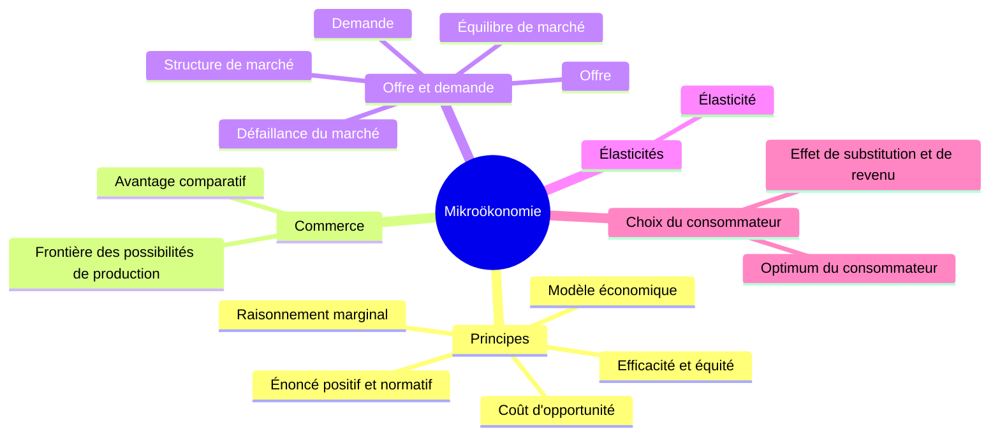

> [!info] Le cours
> **Intitulé :** Volkswirtschaftslehre I – Mikroökonomie
> **Prof :** (à compléter)
> **Langue :** allemand
> **Examen :** Basisprüfung, août 2027, combiné avec la Makroökonomie (FS27) · **Format :** écrit ; 3 tests pendant le semestre
> **Manuel :** Mankiw/Taylor, *Grundzüge der VWL*, 9e éd.

## Vue d'ensemble

## Objectifs (Lernziele)
- Comprendre et savoir **appliquer** les modèles de base (pas les réciter) : le niveau de l'examen est au-dessus du manuel
- Fil rouge du semestre : marchés concurrentiels → interventions (prix plafonds/planchers, taxes, subventions) → structures de marché → limites (théorie des jeux, information asymétrique, rationalité limitée)

## Séances
| # | Date | Vorlesung | Note brute | U-Fragen | Thème |
|---|---|---|---|---|---|
| V01 | 17.09 | Einführung und Grundsätze (chap. 1, 2) | [[NB VWL V01 - 20260917]] | [[UF VWL V01]] | [[Principes de l'économie]] |
| V02 | 24.09 | Interdependenz und Handelsvorteile (chap. 17) | [[NB VWL V02 - 20260924]] | [[UF VWL V02]] | [[Commerce et spécialisation]] |
| V03 | 01.10 | Angebot und Nachfrage (chap. 3) | [[NB VWL V03 - 20261001]] | [[UF VWL V03]] | [[Offre et demande]] |
| V04 | 08.10 | Elastizitäten (chap. 3) | [[NB VWL V04 - 20261008]] | [[UF VWL V04]] | [[Élasticités]] |
| V05 | 15.10 | Theorie der Konsumentenentscheidungen (chap. 4) · Test 1 | [[NB VWL V05 - 20261015]] | [[UF VWL V05]] | [[Choix du consommateur]] |
| V06 | 22.10 | Efficacité des marchés (chap. 7) |  |  |  |
| V07 | 29.10 | Production et coûts (chap. 5) |  |  |  |
| V08 | 05.11 | Concurrence parfaite (chap. 6) |  |  |  |
| V09 | 12.11 | Interventions sur les marchés (chap. 8) · Test 2 |  |  |  |
| V10 | 19.11 | Monopole (chap. 11, 14) |  |  |  |
| V11 | 26.11 | Concurrence monopolistique, oligopole (chap. 12, 13) |  |  |  |
| V12 | 03.12 | Théorie des jeux (chap. 13) |  |  |  |
| V13 | 10.12 | Externalités, biens publics (chap. 10, 9) · Test 3 |  |  |  |
| V14 | 17.12 | Limites de la micro, questions actuelles (chap. 18, 19) |  |  |  |

## Chapitres (ordre du cours)
1. [[Principes de l'économie]] · V01
2. [[Commerce et spécialisation]] · V02
3. [[Offre et demande]] · V03
4. [[Élasticités]] · V04
5. [[Choix du consommateur]] · V05

## ⚠️ Infos examen
- **3 tests écrits** pendant le semestre : V05 (15.10), V09 (12.11), V13 (10.12).
- Examen écrit en août 2027 (Basisprüfung Block 2), combiné avec la Makroökonomie du printemps.
- Le niveau est **au-dessus** du manuel : comprendre et appliquer (calculs, graphiques), pas réciter.
- Préparation : ~2 h/semaine, lire le chapitre **avant** la Vorlesung.
