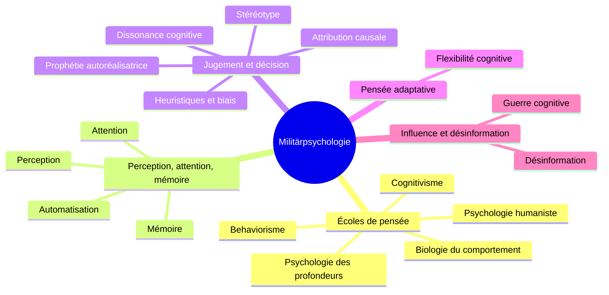

> [!info] Le cours
> **Intitulé :** Militärpsychologie und -pädagogik
> **Prof :** (à compléter)
> **Langue :** allemand
> **Examen :** examen de session, août 2027 · **Format :** écrit, 120 min, en langue maternelle ; contenu HS26 + semaine bloc + FS27, Intermezzi compris

## Vue d'ensemble

## Objectifs (Lernziele)
- Connaître les hypothèses des cinq écoles et expliquer un même cas militaire par chacune (Leitfragen A1–A5)
- Expliquer perception, attention et mémoire, et les transposer à l'instruction et à la conduite
- Expliquer pourquoi nous ne sommes pas rationnels et en tirer des conséquences personnelles
- Relier la flexibilité cognitive au principe d'engagement « flexibilité » (TF 17)
- Définir la guerre cognitive, la situer par rapport à la guerre hybride et expliquer ses mécanismes (Leitfragen 3 et 4)

## Séances
| # | Date | Vorlesung | Note brute | U-Fragen | Thème |
|---|---|---|---|---|---|
| V01 |  | (pas de note) |  |  |  |
| V02 | 22.09 | Psychologisches Denken | [[NB MilPsy V02 - 20260922]] | [[UF MilPsy V02]] | [[Écoles de pensée en psychologie]] |
| V03 | 29.09 | Perception (et fin du psychologisches Denken) | [[NB MilPsy V03 - 20260929]] | [[UF MilPsy V03]] | [[Perception, attention et mémoire]] |
| V04 | 06.10 | Attention, mémoire, pensée et décision | [[NB MilPsy V04 - 20261006]] | [[UF MilPsy V04]] | [[Perception, attention et mémoire]] · [[Jugement et décision]] |
| V05 | 13.10 | Flexibilité cognitive et guerre cognitive | [[NB MilPsy V05 - 20261013]] | [[UF MilPsy V05]] | [[Pensée et action adaptatives]] · [[Influence et désinformation]] |

## Chapitres (ordre du cours)
1. [[Écoles de pensée en psychologie]] · V02–V03
2. [[Perception, attention et mémoire]] · V03–V04
3. [[Jugement et décision]] · V04
4. [[Pensée et action adaptatives]] · V05
5. [[Influence et désinformation]] · V03, V05

## ⚠️ Infos examen
- Écrit, 120 min, en **langue maternelle** ; août 2027 (Basisprüfung Block 2).
- Trois niveaux : **Wissen** (nommer, définir) · **Verstehen** (expliquer, comparer, justifier) · **Anwenden** (appliquer à une situation militaire).
- Les **Leitfragen** du cours servent de préparation.
- **Intermezzo** : non noté, mais condition d'admission à l'examen (praxisbeispiel 11.10, Crosscheck 27.10, Kurzreflexion 16.11).
- ?? À demander à la prof : l'effet d'ancrage est-il matière d'examen ? Leitfrage 5d (humaniste).
