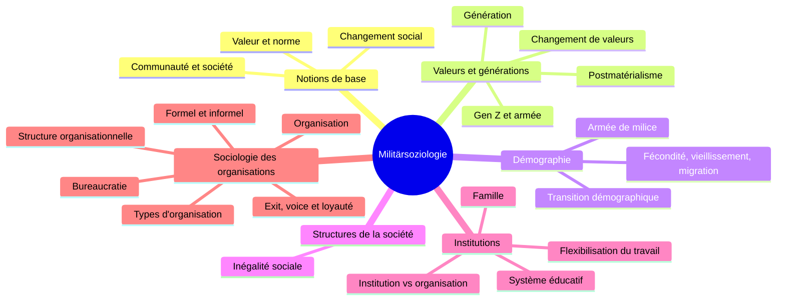

> [!info] Le cours
> **Intitulé :** Militärsoziologie I : Gesellschaft und Militär
> **Prof :** Tibor Szvircsev Tresch (responsable), Stefano De Rosa, Thomas Ferst
> **Langue :** allemand (examen possible en allemand, français ou italien)
> **Examen :** 14.12.2026, 14:15–15:45 · **Format :** écrit, 90 min, **3 questions thématiques**, sans documents ; travail de groupe = 1/4 de la note

## Vue d'ensemble

## Objectifs (Lernziele)
- Définir la sociologie, valeur, norme et changement social, et les utiliser pour analyser l'armée
- Expliquer le changement de valeurs depuis 1945 (Inglehart) et ses conséquences pour l'organisation militaire
- Décrire l'évolution démographique de la Suisse, ses chances et ses défis, et en tirer les conséquences pour l'armée de milice
- Connaître les principales théories de l'inégalité sociale
- Distinguer institution et organisation ; décrire l'évolution des grandes institutions en Suisse
- Expliquer pourquoi les organisations existent, comment on les classe, comment elles sont structurées et quels problèmes elles rencontrent
- Fil rouge : chaque changement de la société → conséquences pour l'organisation militaire

## Séances
| # | Date | Vorlesung | Note brute | U-Fragen | Thème |
|---|---|---|---|---|---|
| V01 | 21.09 | Grundbegriffe der Soziologie / Sozialer Wandel | [[NB MilSoz V01 - 20260921]] | [[UF MilSoz V01]] | [[Notions de base de la sociologie]] |
| V02 | 28.09 | Wertewandel / Generationen | [[NB MilSoz V02 - 20260928]] | [[UF MilSoz V02]] | [[Changement des valeurs et générations]] |
| V03 | 05.10 | Demografische Veränderung der Gesellschaft | [[NB MilSoz V03 - 20261005]] | [[UF MilSoz V03]] | [[Changement démographique]] |
| V04 | 12.10 | Strukturen der Gesellschaft | [[NB MilSoz V04 - 20261012]] | [[UF MilSoz V04]] | — (hors Prüfungshinweis) |
| V05 | 19.10 | Institutionen der Gesellschaft | [[NB MilSoz V05 - 20261019]] | [[UF MilSoz V05]] | [[Institutions de la société]] |
| V06 | 26.10 | Organisationen | [[NB MilSoz V06 - 20261026]] | [[UF MilSoz V06]] | [[Sociologie des organisations]] |

## Chapitres (ordre du cours)
1. [[Notions de base de la sociologie]] · V01
2. [[Changement des valeurs et générations]] · V02 ⚠️ Prüfungshinweis
3. [[Changement démographique]] · V03 ⚠️ Prüfungshinweis
4. [[Institutions de la société]] · V05
5. [[Sociologie des organisations]] · V06 ⚠️ Prüfungshinweis

## ⚠️ Infos examen
- Prüfungshinweis : tout ce qui a été traité, **y compris les textes du reader**. Thèmes cités : Demografie, Wertewandel ; Organisationen als gesellschaftliches Phänomen, Ziele/Strukturen/Umwelten von Organisationen ; Grundlagen der Militärsoziologie, Militär : Sonderfall oder Organisation wie jede andere ?
- 3 questions thématiques sur papier ; structure attendue (dit en cours, V05) : **description**, puis **application / interprétation** avec forces, faiblesses et un exemple.
- Les questions de discussion posées en cours sont la forme probable des questions d'examen.
- Lire et décrire une pyramide des âges = classique d'examen.
- V04 (Strukturen der Gesellschaft) : pas une question à part entière, mais utile pour argumenter (statut, prestige de l'officier, habitus).
- V05 : la distinction **institution ≠ organisation** prépare V11 (*Militär : Institution und Organisation*).
- V06 : séance du responsable du cours ; typologie d'Etzioni, structure, bureaucratie, formel/informel, exit/voice → base de la question « l'armée, une organisation comme les autres ? ».
