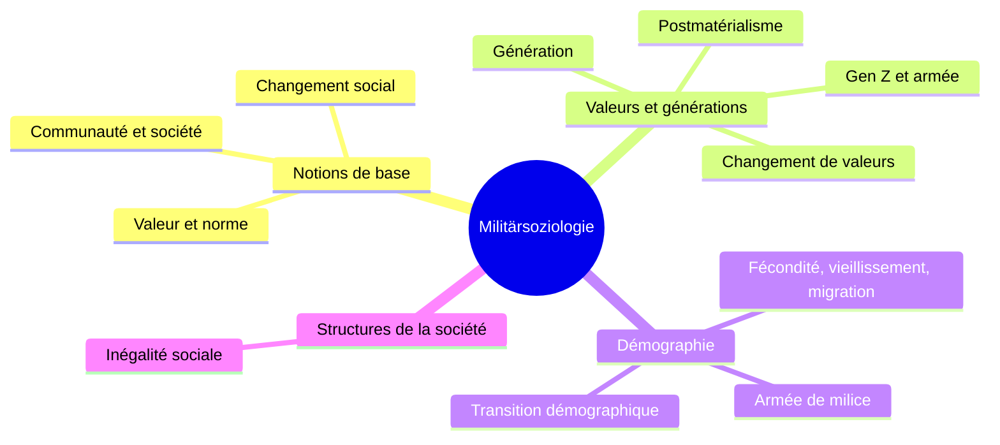

> [!info] Le cours
> **Intitulé :** Militärsoziologie (Allgemeine Soziologie)
> **Prof :** (à compléter)
> **Langue :** allemand
> **Examen :** (format à compléter) · Prüfungshinweis : **Demografie** et **Wertewandel** pour l'Allgemeine Soziologie

## Vue d'ensemble

## Objectifs (Lernziele)
- Définir la sociologie, valeur, norme et changement social, et les utiliser pour analyser l'armée
- Expliquer le changement de valeurs depuis 1945 (Inglehart) et ses conséquences pour l'organisation militaire
- Décrire l'évolution démographique de la Suisse, ses chances et ses défis, et en tirer les conséquences pour l'armée de milice
- Connaître les principales théories de l'inégalité sociale
- Fil rouge : chaque changement de la société → conséquences pour l'organisation militaire

## Séances
| # | Date | Vorlesung | Note brute | U-Fragen | Thème |
|---|---|---|---|---|---|
| V01 | 21.09 | Grundbegriffe der Soziologie / Sozialer Wandel | [[NB MilSoz V01 - 20260921]] | [[UF MilSoz V01]] | [[Notions de base de la sociologie]] |
| V02 | 28.09 | Wertewandel / Generationen | [[NB MilSoz V02 - 20260928]] | [[UF MilSoz V02]] | [[Changement des valeurs et générations]] |
| V03 | 05.10 | Demografische Veränderung der Gesellschaft | [[NB MilSoz V03 - 20261005]] | [[UF MilSoz V03]] | [[Changement démographique]] |
| V04 | 12.10 | Strukturen der Gesellschaft | [[NB MilSoz V04 - 20261012]] | [[UF MilSoz V04]] | — (hors Prüfungshinweis) |

## Chapitres (ordre du cours)
1. [[Notions de base de la sociologie]] · V01
2. [[Changement des valeurs et générations]] · V02 ⚠️ Prüfungshinweis
3. [[Changement démographique]] · V03 ⚠️ Prüfungshinweis

## ⚠️ Infos examen
- Prüfungshinweis (Allgemeine Soziologie) : **Demografie** et **Wertewandel** uniquement.
- Les questions de discussion posées en cours sont la forme probable des questions d'examen.
- Lire et décrire une pyramide des âges = classique d'examen.
- V04 (Strukturen der Gesellschaft) : pas une question à part entière, mais utile pour argumenter (statut, prestige de l'officier, habitus).
