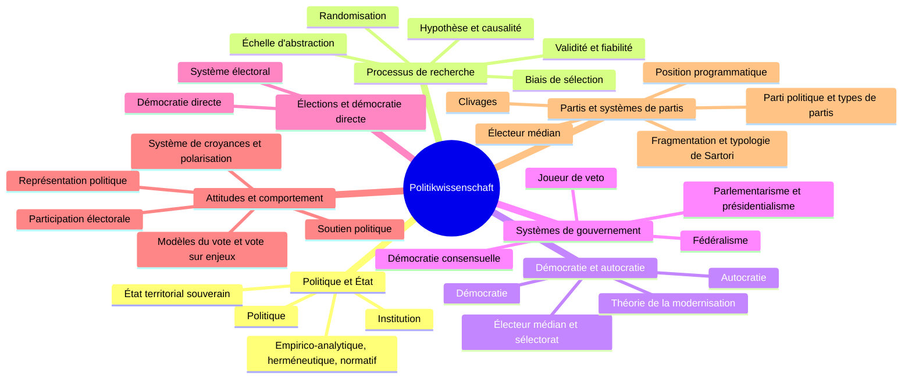

> [!info] Le cours
> **Intitulé :** Politikwissenschaft Grundlagen
> **Prof :** (à compléter)
> **Langue :** allemand
> **Examen :** [[Basispruefung 2027 - Block 1|Basisprüfung 2027 – Block 1]] · **Format :** (à compléter)
> **Manuel :** Bernauer et al. 2025, *Einführung in die Politikwissenschaft*

## Vue d'ensemble

## Objectifs (Lernziele)
- (à compléter avec les objectifs officiels du cours)

## Séances
| # | Date | Vorlesung | Note brute | U-Fragen | Thème |
|---|---|---|---|---|---|
| V01 | 21.09 | Einführung – Was ist Politikwissenschaft? (Kap. 1) | [[NB PW V01 - 20260921]] | [[UF PW V01]] | [[Politique, État et science politique]] |
| V02 | 28.09 | Der Forschungsprozess (Kap. 2) | [[NB PW V02 - 20260928]] | [[UF PW V02]] | [[Processus de recherche empirico-analytique]] |
| V03 | 05.10 | Grundformen politischer Systeme · Demokratische Regierungssysteme (Kap. 3–4) | [[NB PW V03 - 20261005]] | [[UF PW V03]] | [[Démocratie et autocratie]] · [[Systèmes de gouvernement démocratiques]] |
| V04 | 12.10 | Wahlen und direkte Demokratie (Kap. 5) | [[NB PW V04 - 20261012]] | [[UF PW V04]] | [[Élections et démocratie directe]] |
| V05 | 19.10 | Politische Einstellungen und Verhalten (Kap. 6) | [[NB PW V05 - 20261019]] | [[UF PW V05]] | [[Attitudes et comportement politiques]] |
| V06 | 26.10 | Parteien und Parteiensysteme (Kap. 7) | [[NB PW V06 - 20261026]] | [[UF PW V06]] | [[Partis et systèmes de partis]] |

## Chapitres (ordre du cours)
1. [[Politique, État et science politique]] · V01
2. [[Processus de recherche empirico-analytique]] · V02
3. [[Démocratie et autocratie]] · V03
4. [[Systèmes de gouvernement démocratiques]] · V03
5. [[Élections et démocratie directe]] · V04
6. [[Attitudes et comportement politiques]] · V05
7. [[Partis et systèmes de partis]] · V06

## ⚠️ Infos examen
- (à compléter)
