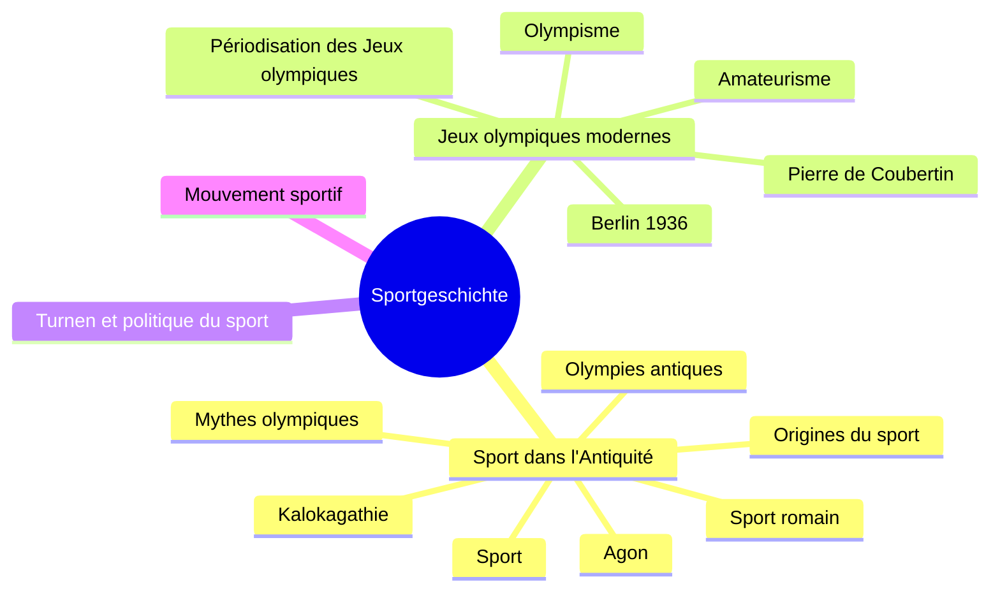

> [!info] Le cours
> **Intitulé :** Sportgeschichte (option, S1)
> **Prof :** Marcel Gisler
> **Langue :** allemand ; questions et réponses possibles en allemand, français ou italien
> **Examen :** écrit, 17.12.2026, 16.15–17.30 (75 min), sur laptop (exam.net) · **Format :** 4 Lernzielfragen (12 pts) + 12 MC (12 pts) + 6 images (12 pts) ; 32 pts = 6, 20 pts = 4

## Vue d'ensemble

## Objectifs (Lernziele)
- Comprendre que les phénomènes sportifs sont historiques et inachevés (ex. olympisme)
- Apprendre de l'histoire (ex. rôle des femmes)
- Acquérir une compétence large (ex. loi sur l'encouragement du sport 2012)
- Pour l'examen : Lernzielfragen, Begriffe, Personen (sans dates) et 5 dates au début de chaque chapitre du script

## Séances
| # | Date | Vorlesung | Note brute | U-Fragen | Thème |
|---|---|---|---|---|---|
| V01 | 17.09 | Auftakt, Begriff, Ursprünge (Anker, Watussi) | [[NB Sport V01 - 20260917]] | [[UF Sport V01]] | [[Sport dans l'Antiquité]] |
| V02 | 24.09 | Olympies antiques, sport romain (Zeus, BD) | [[NB Sport V02 - 20260924]] | [[UF Sport V02]] | [[Sport dans l'Antiquité]] |
| — | 01.10 | annulée : lecture Script p. 24–29 |  |  |  |
| V03 | 08.10 | Idéaux olympiques, 1896–1912 (Wenlock et Mandeville, Pietri) | [[NB Sport V03 - 20261008]] | [[UF Sport V03]] | [[Jeux olympiques modernes]] |
| — | 15.10 | annulée : lecture « Berlin 1936 », Script p. 30, 37–44 |  |  |  |
| V04 | 22.10 | 1920–1936, Berlin 1936 (Owens ; Dream Team 1992) | [[NB Sport V04 - 20261022]] | [[UF Sport V04]] | [[Jeux olympiques modernes]] |
| V05 | 29.10 | Beijing 2008 et 2022, Peng Shuai |  |  |  |
| V06 | 05.11 | Sotchi 2014, Paris 2024, femmes aux JO (Switzer) |  |  |  |
| V07 | 12.11 | Turnen de Jahn, Magglingen, obligatoire scolaire |  |  |  |
| V08 | 19.11 | Sport en RDA (fête socialiste, Heidi Krüger) |  |  |  |
| V09 | 26.11 | Sports anglais, débuts du football (boxe, basket) |  |  |  |
| V10 | 03.12 | Football au XXe s., football féminin (Wunder von Bern, Madeleine Boll) |  |  |  |
| V11 | 10.12 | Sports d'hiver en Suisse (Leif Berg, Snurfer), Repetitorium |  |  |  |
| — | 17.12 | Examen écrit |  |  |  |

## Chapitres (ordre du script)
1. [[Sport dans l'Antiquité]] · V01–V02 (ch. 2)
2. [[Jeux olympiques modernes]] · V03–V06 (ch. 3)
3. Turnen et politique du sport · V07–V08 (ch. 4)
4. Le mouvement sportif · V09–V11 (ch. 5)

## ⚠️ Infos examen
- Les 5 dates à connaître : 776 av. J.-C., 394, 1874, 1896, 1972 (apprendre « de droite à gauche » : événement → date)
- Personnes : pas de dates à apprendre
- Begriffe : connaître le sens, pas la formulation exacte
- MC : plusieurs réponses justes ou fausses par question
- Images : décrire, interpréter, situer dans le contexte (liste complète dans le PDF « Prüfungsfragen »)
- Pièges repérés : Kalokagathia (la liste inverse *kalos* / *agathos*), 393/394, début de la phase 4 (1948/1952), Thomas/Heinrich Mann
