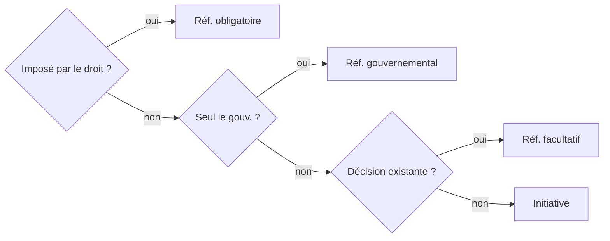

# Élections et démocratie directe

PW · Chapitre 5 · *Wahlen und direkte Demokratie*

---

## Mode d'emploi

- **AVOR** : parcourir une fois avant le cours (10 min)
- **Refresh** : répondre à chaque 🧠 **avant** de déplier
- Un lien `[[…]]` qui ne revient pas → ouvrir la note concept

Thème : [[Élections et démocratie directe]]
Course Map : [[HS26 - Politikwissenschaft]]

---

## Le chapitre en 30 secondes

| | Élections | Démocratie directe |
|---|---|---|
| On choisit… | des **personnes** | une **question de fond** |
| Logique | **délégation** | **pas** de délégation |
| Rythme | régulier | sans calendrier |

Point commun : fonction de **contrôle** et de **légitimation**.

> [!question]- 🧠 Les deux différences entre élection et votation ?
> 1. Personnes pour un temps (délégation) vs question de fond (sans délégation).
> 2. Régulières vs sans régularité.

---

## À quoi servent les élections ?

| Nohlen | Démocratie | Autoritaire | Totalitaire |
|---|---|---|---|
| Choix | élevé | faible | aucun |
| Question du pouvoir posée ? | **oui** | non | non |
| Légitime le système ? | oui | un peu | non |

En autocratie : pas de compétition, mais un **signal** (intérieur : stabiliser ; extérieur : paraître démocratique).

---

## Cinq conditions démocratiques

==allgemein · gleich · frei · direkt · geheim==

… et **régulières** : le pouvoir n'est délégué que pour un temps.

> [!question]- 🧠 Pourquoi la régularité compte-t-elle ?
> Le pouvoir peut être retiré, donc **contrôlé**.

---

## Quatre caractéristiques d'un système

1. **Découpage** : sièges par circonscription → proportionnalité
2. **Offre et vote** : liste bloquée / libre (CH : ==kumulieren, panaschieren==)
3. **Conversion des voix** : majoritaire vs proportionnel → **le critère clé**
4. **Obligation** de vote ↑ participation ; d'inscription ↓

> [!warning]- Chiffre
> VL : 659 circonscriptions en GB ; manuel : 650 (actuel).

---

## Le seuil naturel

**Seuil ≈ 1 / nombre de sièges** → [[Seuil électoral]]

| Circonscription | Sièges | Seuil |
|---|---|---|
| Zurich | 36 | 2,8 % |
| Saint-Gall | 12 | 8,3 % |
| Zoug | 3 | **33,3 %** |

> [!question]- 🧠 Pourquoi la proportionnelle à Zoug ressemble-t-elle au majoritaire ?
> Avec 3 sièges, il faut ~33 % pour un siège : la **taille de la circonscription** fait la proportionnalité.

---

## Ne pas confondre

- Seuil **naturel** ≠ seuil **formel** (légal) : DE 5 %, AT 4 %, **CH aucun**
- ==Gerrymandering== : découpage **intentionnel** (Gerry, 1812)
- ≠ ==Malapportionment== : déséquilibre dû à la **démographie**

---

## Majoritaire vs proportionnel

→ [[Système électoral]]

| | ==Majorz== | ==Proporz== |
|---|---|---|
| Règle | majorité dans la circonscription | sièges ∝ voix |
| Objectif | **stabilité**, responsabilité | **représentation juste** |
| Exemples | GB, USA, CH États | NL, Scandinavie, CH National |

> [!warning]- Piège
> Ne pas juger le majoritaire avec le critère du proportionnel : chacun vise **son** objectif.

---

## Les majorités fabriquées

**GB 2024** : Labour **34 %** des voix → **63 %** des sièges

| Type | Définition |
|---|---|
| Fabriquée | sièges sans majorité des voix |
| Méritée | sièges **et** voix |
| Minorité naturelle | ni l'un ni l'autre |
| Apparente | le **2e** en voix gagne les sièges |

---

## Mesurer la disproportionnalité

- Lijphart 1945–96 : majoritaire → **44 %** de majorités fabriquées ; proportionnel → **82 %** de minorités naturelles
- Indice de **Gallagher** : GB 23,6 vs CH 3,6

> [!question]- 🧠 Un indice de Gallagher élevé signifie…?
> Une **forte disproportionnalité** entre voix et sièges.

---

## Pourquoi la proportionnelle ?

| Auteur | Idée |
|---|---|
| Boix (1999) | les partis établis craignent les socialistes |
| Cusack et al. (2010) | intégration locale ancienne (corporatisme) |
| Cox et al. (2019) | contrôle des listes, discipline (Norvège) |

---

## Effets : électeurs et élus

| | Majoritaire | Proportionnel |
|---|---|---|
| Le vote est… | jugement du gouvernement | choix de représentants |
| Participation | plus basse | plus haute |
| Campagne | ==bridging== | ==bonding== |
| L'élu dépend de… | sa circonscription | son parti |

---

## Effets : partis, gouvernement, société

| | Majoritaire | Proportionnel |
|---|---|---|
| Système de partis | bipartisme | multipartisme |
| Gouvernement | un parti | coalition |
| Responsabilité | claire | diffuse |
| Minorités | moins représentées | mieux représentées |

---

## La « loi » de Duverger

→ [[Loi de Duverger]]

« Loi » **contestée** : une tendance, pas un déterminisme.

> [!question]- 🧠 Mécanique vs psychologique ?
> **Mécanique** : la règle sous-représente les tiers partis. **Psychologique** : électeurs et candidats les abandonnent (vote utile).

---

## Directe, semi-directe, représentative

→ Démocratie semi-directe

| Forme | Exemple |
|---|---|
| Directe pure | Athènes |
| **Semi-directe** | **Suisse** |
| Représentative pure | Allemagne (fédéral) |

« Démocratie directe » au sens courant = **semi-directe**.

---

## Trois questions, quatre instruments

Hug et Tsebelis (2002) → [[Référendum]] · [[Initiative populaire]]

---

## Le référendum freine

1. Plus le projet s'éloigne du **statu quo**…
2. … et plus les opposants sont forts, plus il risque de tomber.
3. Donc : **compromis** et ==Vernehmlassung==.

**Obligatoire** : vote certain → projets encore plus prudents.

---

## Le référendum gouvernemental

- Déléguer une décision, forcer l'opposition à se positionner
- Apaiser une coalition divisée (Brexit 2016)

> [!question]- 🧠 Pourquoi n'a-t-il pas de fonction de contrôle ?
> Seul le gouvernement le déclenche : il renforce le gouvernement au lieu de le contrôler.

---

## L'initiative accélère

| But | Idée |
|---|---|
| Soupape | imposer une demande (rare) |
| Monnaie d'échange | obtenir un **contre-projet** |
| Catalyseur | mettre un thème à l'agenda |
| Aide électorale | notoriété, mobilisation |

**Dilemme** : proche du statu quo = acceptée, mais peu innovante.

---

## Suisse : les chiffres (1848–2024)

| Instrument | Majorité | Acceptés |
|---|---|---|
| Réf. obligatoire | peuple + cantons | **73 %** |
| Réf. facultatif | peuple | **59 %** |
| Initiative | peuple + cantons | **< 10 %** |

> [!question]- 🧠 Pourquoi l'obligatoire réussit-il mieux ?
> Le vote est certain : le parlement reste proche du statu quo dès le départ.

---

## Suisse : les seuils

- Réf. facultatif : **50 000** signatures ou **8 cantons** en **100 jours**
- Initiative : **100 000** signatures, contre-projet possible

> [!warning]- Pièges
> - Un **oui** au référendum = oui au projet du **parlement**.
> - Majorité des **cantons** : obligatoire et initiative seulement.

---

## Même instrument, autre effet

| Suisse → compromis | Californie → conflit |
|---|---|
| gouvernement collégial | présidentiel |
| multipartisme | deux partis polarisés |
| compromis dès le lancement | contourne le parlement |

À retenir : les instruments **ne se transposent pas**.

---

## Approfondissement : Skorge (2023)

- **Question** : la proportionnelle réduit-elle l'écart de participation hommes-femmes ?
- **Mécanisme** : chaque voix compte partout → les élites mobilisent aussi les femmes
- **Méthode** : quasi-expérience, Norvège 1919

> [!warning]- À vérifier
> VL (diapo 38) : « circonscriptions **disputées** ». La logique suggère plutôt les **non disputées**.

---

## Synthèse

| Concept | À retenir |
|---|---|
| [[Seuil électoral]] | taille de circonscription = proportionnalité |
| [[Loi de Duverger]] | majoritaire → bipartisme (tendance) |
| [[Référendum]] | frein, force le compromis |
| [[Initiative populaire]] | accélérateur, succès souvent indirect |

---

## Sources

- Bernauer et al., *Einführung in die Politikwissenschaft*, chap. 5
- VL 4 « Wahlen und Direkte Demokratie », 12.10.2026
- Suite : chap. 6 (électeurs), 7 (partis), 10–11 (coalitions)
